  

  

  
  
  
  

 

<h2 align="center">
  
</h2>

 

  Hello There! 👋 <em><b>I'm Giovana Lopes</b></em>, a third-semester Systems Analysis and Development student. This little corner of the internet is where I keep my <b>projects</b> and my <b>programming studies</b>, and where I share what I learn along the way. 🌸 I'm always curious to learn something new, build things and grow as a developer.

  

   
   <code>Studying at FATEC</code>
  &nbsp;&nbsp;
   <code>Learning more every day</code>
  &nbsp;&nbsp;
   <code>Open for conversations</code>
    

  

 

<h2 align="center">
  
</h2>

  
  
  
  
  
  
  

  
  

  

  

